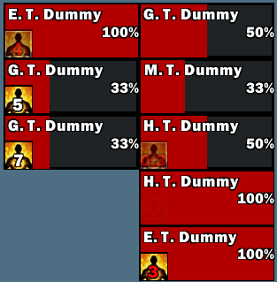
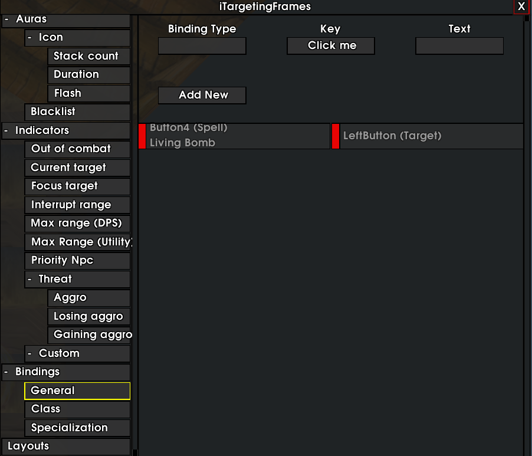
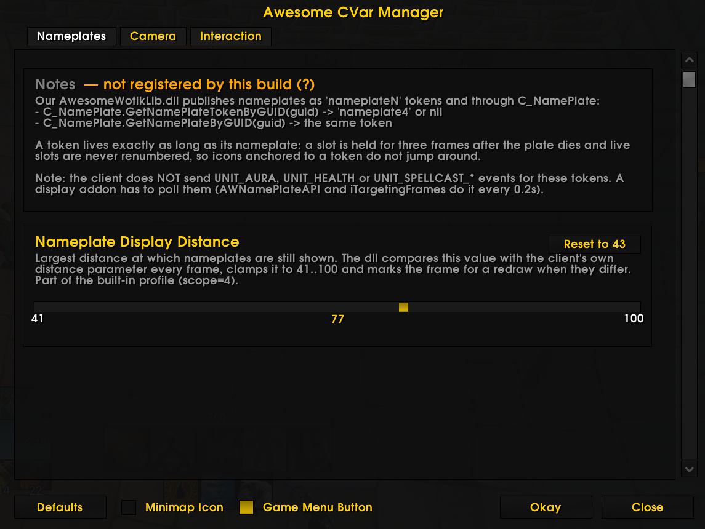
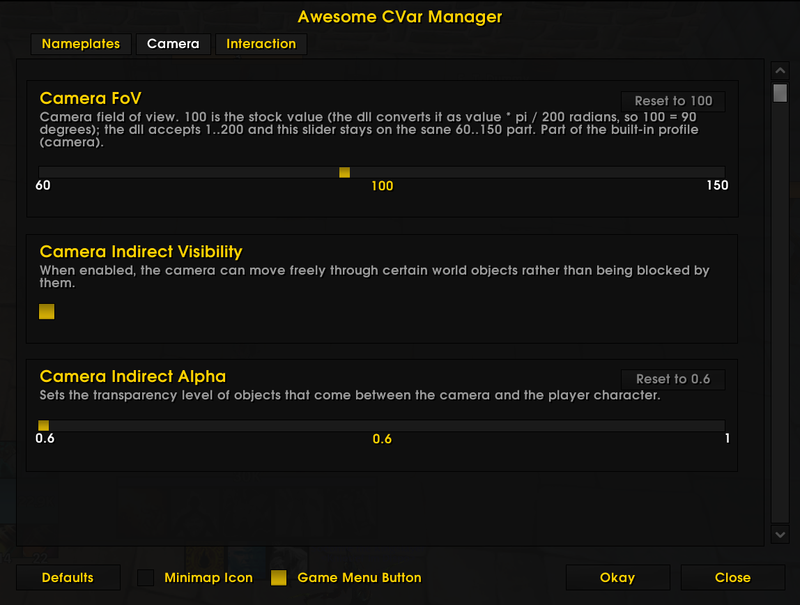
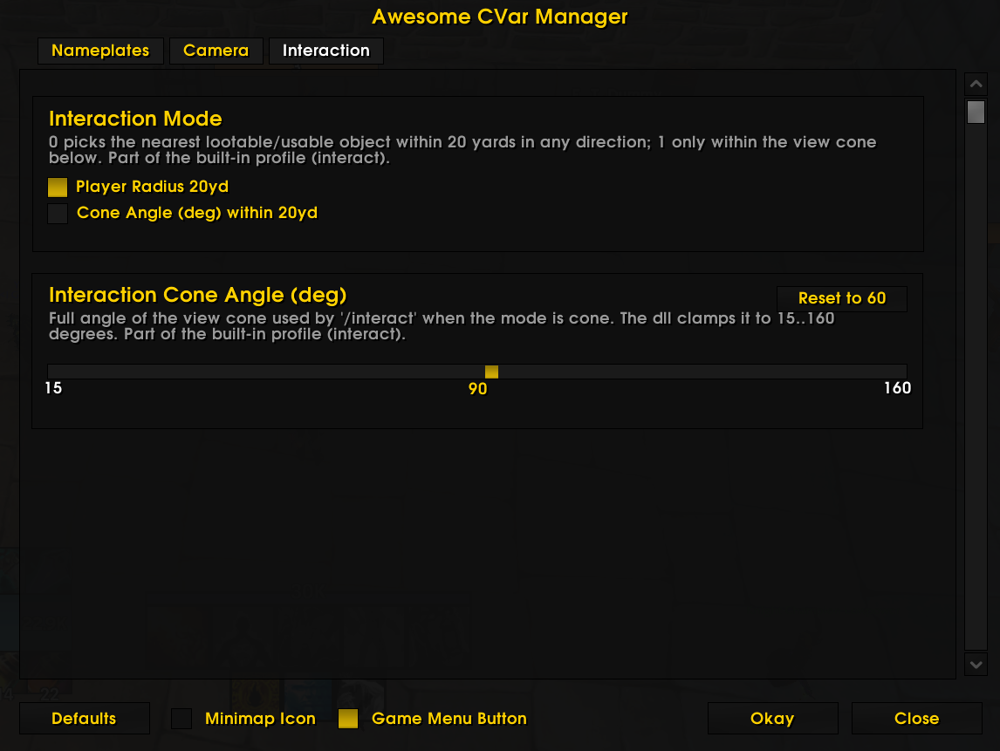

<p align="center">
  
</p>

<p align="center">
  
  
  
</p>

<h1 align="center">iTargetingFrames — WotLK 3.3.5a fork</h1>

<p align="center">
  <b>Nameplate targeting frames for World of Warcraft 3.3.5a (WotLK).</b><br>
  <i>Fork of iTargetingFrames, brought back to the 3.3.5a client.</i>
</p>

<p align="center">
  <a href="#english">English</a> ·
  <a href="#russian">Русский</a>
</p>

---

<a name="english"></a>
## English

<p align="center">
  <a href="#features">Features</a> ·
  <a href="#commands">Commands</a> ·
  <a href="#installation">Installation</a> ·
  <a href="#credits">Credits</a>
</p>

### About

**iTargetingFrames** replaces the default enemy nameplates with your own frames —
one frame per visible unit, showing name, health, cast bar, auras, raid icon and a
set of targeting indicators, all with click bindings on top.

This repository is a **fork for the WoW 3.3.5a (WotLK) client**. The original addon
targeted later expansions; here it is adapted to what the 3.3.5a API actually
provides.

Alongside the addon the repository carries the client library it is written for,
`AwesomeWotlkLib.dll`, the two small addons that read it: **AWNamePlateAPI**
publishes the `nameplateN` unit tokens, the `/interact` channel and the yard labels,
**AwesomeCVar** is the `/awesome` window with the controls the library registers and
with the tab those labels are set up on — and `AwesomeWotlkPatch.exe`, the small program
that writes the three places in `Wow.exe` so the client loads the library at all. Both binaries here are built from
[keoo88/awesome_wotlk](https://gitlab.com/keoo88/awesome_wotlk), and [its release v0.5](https://gitlab.com/keoo88/awesome_wotlk/-/releases/v0.5)
lists the size, md5 and sha256 of exactly these two files together with the command and the toolset that
reproduce them. The addon loads
without them and simply falls back to the stock 3.3.5a lookups, which can put one
unit into several frames; with them the tokens stay stable for the whole session.
Nothing here is mandatory — every call into the library is guarded, so a client
without it just loses those controls.

<a name="features"></a>
### Features

#### Frame Layout



Position, row count, growth direction, spacing, width and height are all yours.
Cap the number of frames you are willing to draw, or leave it uncapped; optionally
hide friendly units entirely or only in combat.

#### Health and Cast Bars

Health bar with class colours or a plain bar colour, optional health text with a
configurable number of decimals and a `%` sign. The cast bar shows the unit name
and the cast, uses its own colour and a separate colour for casts that cannot be
interrupted, and can be detached from the frame and moved anywhere on screen.

#### Auras

Icons for buffs and debuffs, capped by the *Max auras* setting and filtered by a
blacklist. Duration text and stack count, flashing under a configurable number of
seconds at a configurable speed, and sorting by time or by name in either
direction.

#### Indicators

Every frame can carry indicators for **out of combat**, **current target**,
**focus target**, **interrupt range**, **max range (DPS)** and **max range
(utility)** — the range indicators light up per your current specialization's
spell, so you see at a glance who is still reachable.

#### Threat

Aggro, losing aggro and gaining aggro each get their own indicator, weight and
colour.

#### Custom Conditionals

Write your own indicators as plain Lua functions and drive them with the built-in
conditionals — update, aura, cast, health, target change, focus, threat and show.
A set of templates is included to start from, and each conditional has a name, an
invert flag, a weight, a colour and an enable toggle.

#### Bindings

Bind spells, macros, targets and focuses to mouse buttons and keys right on the
frame — including per-class and per-spec binding sets. A warning banner tells you
when you are in keybinding mode, and a "Click me" label marks the frame that is
waiting for a key.


#### Roles and Priority NPCs

Restrict frames by role (tank / all / dps-healer) so you only see what your job
needs. A priority NPC list accepts an NPC id or name plus a comment, and can
optionally accept additions from your group.

#### Appearance

Global and per-part fonts and textures, status-bar and cast-bar textures, frame
background colour, border colour and border size, frame opacity, name colour and
raid icons. Text flags cover none, outline, thick outline and monochrome.

#### Client controls

`AwesomeWotlkLib.dll` adds the controls this addon is built around, and `/awesome`
shows them. `nameplateDistance` sets how far the client keeps a nameplate alive, so
it is the range at which a frame can appear at all.



`cameraFov` opens the field of view. `cameraIndirectVisibility` dims the models
standing between the camera and your target, and `cameraIndirectAlpha` sets how
strong that dim is.



`interactionMode` and `interactionAngle` drive `/interact`, which takes the unit you
are actually aiming at instead of the closest raw target.



`distanceDisplay` is the single switch for the yard numbers: the library measures the
distance to every visible nameplate and to your target and focus, and **AWNamePlateAPI**
draws what it measured. Font, outline, size, colour, anchor and offsets are set per plate
type on the Distance tab of `/awesome`, with their own profile for the target frame and
another one for the focus, and they survive a reload. `/awdistance` prints what those
labels actually see, which is the quickest way to find out why one of them is missing.

<a name="commands"></a>
### Commands

| Command | Description |
| --- | --- |
| `/itf` | Open the settings window |
| `/itf reset` | Reset everything to defaults |
| `/itf <anything else>` | Print the command help |
| `/awesome` | Open the window with the library controls |
| `/interact [unit]` | Use the nearest object you are facing, or the named one (`target`, `focus`, `mouseover`, `nameplate3`) |
| `/awdistance` | Print what the distance labels actually see |

<a name="installation"></a>
### Installation

1. Download the latest release (or clone this repository) and unpack it.
2. Move `AwesomeWotlkLib.dll` to the client root, next to `Wow.exe`. Its settings are
   compiled in, so there is no config file to place.
3. Run `AwesomeWotlkPatch.exe` from the same folder. It writes three bytes into `Wow.exe`
   so the client loads the library on start — without this step the dll is a file the game
   never reads. The patcher saves `Wow.exe.bak` next to it before writing, repeats do no
   work ("Patch is already applied"), and ask before touching anything that is not the
   3.3.5a (12340) client.
4. Move the three addon folders into:
   ```
   \Interface\AddOns\
   ```
5. Enable them on the character select screen and start the game. `/itf` opens the
   frames, `/awesome` opens the controls.

The final path has to look like `\Interface\AddOns\iTargetingFrames\iTargetingFrames.toc`.

### Compatibility

- Built and tested on **Warmane** (WoW 3.3.5a, Interface `30300`).
- Developed exclusively for **Warmane**. I take no responsibility for other servers.

<a name="credits"></a>
### Credits

- Original addon: **Ironi** — iTargetingFrames
- Backport to WotLK 3.3.5a: **Cheeta**
- Original AwesomeCVar: **noname08662**
- This fork: **Keoo** — [discord.gg/sKpJbUrsvR](https://discord.gg/sKpJbUrsvR)

---

<a name="russian"></a>
## Русский

<p align="center">
  <a href="#возможности">Возможности</a> ·
  <a href="#команды">Команды</a> ·
  <a href="#установка">Установка</a> ·
  <a href="#благодарности">Благодарности</a>
</p>

### Об аддоне

**iTargetingFrames** заменяет стандартные таблички противников своими рамками —
по одной на каждого видимого юнита, с именем, здоровьем, полосой каста, аурами,
рейдовой меткой и набором индикаторов наведения, и с привязками кликов поверх
всего этого.

Этот репозиторий — **форк под клиент WoW 3.3.5a (WotLK)**. Оригинальный аддон
писался под более поздние дополнения; здесь он приведён к тому, что реально умеет
API 3.3.5a.

Кроме аддона в репозитории лежит библиотечка для клиента, `AwesomeWotlkLib.dll`,
два маленьких аддона, которые из неё читают: **AWNamePlateAPI** отдаёт токены юнитов
`nameplateN`, канал `/interact` и подписи дистанции, **AwesomeCVar** — окно `/awesome`
с контролами, которые библиотека регистрирует, и с вкладкой, на которой эти подписи
настраиваются, — и `AwesomeWotlkPatch.exe`, маленькая программа, которая вписывает в
`Wow.exe` три места, чтобы клиент вообще загрузил библиотеку. Обе эти программы собраны из
[keoo88/awesome_wotlk](https://gitlab.com/keoo88/awesome_wotlk), и в [релизе `v0.5` того репозитория](https://gitlab.com/keoo88/awesome_wotlk/-/releases/v0.5)
лежат размер, md5 и sha256 ровно тех файлов, что идут в этом архиве, -- вместе с командой сборки и тулсетом.
Без них аддон тоже загрузится, но уйдёт в штатные
поиски неймплейтов 3.3.5a и может показать одного юнита в нескольких рамках; с ними
токены остаются стабильными всю сессию. Обязательного тут ничего нет — каждый вызов
в библиотеку защищён, и на клиенте без неё просто теряются соответствующие контролы.

<a name="возможности"></a>
### Возможности

#### Расположение рамок (Frame Layout)


Позиция, число строк, направление роста, отступы, ширина и высота — всё
настраивается. Можно ограничить число одновременно рисуемых рамок или не
ограничивать вовсе; дружественные юниты прячутся совсем либо только в бою.

#### Полосы здоровья и каста (Health and Cast Bars)

Полоса здоровья с цветами классов или сплошным цветом, необязательный текст
здоровья с настраиваемым числом знаков после запятой и знаком `%`. Полоса каста
показывает имя юнита и название каста, имеет свой цвет и отдельный цвет для
кастов, которые нельзя прервать, и может быть откреплена от рамки и перенесена
куда угодно на экране.

#### Ауры (Auras)

Иконки баффов и дебаффов с ограничением по числу и с чёрным списком. Текст
длительности и счётчик стаков, мигание ниже заданного числа секунд с настраиваемой
скоростью, сортировка по времени или по имени в любую сторону.

#### Индикаторы (Indicators)

На каждой рамке могут гореть индикаторы **вне боя**, **текущая цель**, **цель
фокуса**, **дистанция прерывания**, **максимальная дистанция (DPS)** и
**максимальная дистанция (утилити)** — индикаторы дистанции считаются по
заклинанию вашего текущего специализации, так что сразу видно, кто ещё доступен.

#### Угроза (Threat)

Агро, потеря агро и набор агро — у каждого свой индикатор, вес и цвет.

#### Пользовательские условия (Custom Conditionals)

Свои индикаторы пишутся обычными функциями на Lua и привязываются к встроенным
условиям — обновление, аура, каст, здоровье, смена цели, фокус, угроза и
появление. В комплекте есть шаблоны, с которых можно начать; у каждого условия
есть имя, флаг инверсии, вес, цвет и переключатель.

#### Привязки (Bindings)

Заклинания, макросы, цели и фокус вешаются на кнопки мыши и клавиши прямо на
рамке — в том числе отдельными наборами для класса и для специализации. Баннер
предупреждает о режиме назначения клавиш, а надпись «Click me» помечает рамку,
которая ждёт нажатия.


#### Роли и приоритетные NPC (Roles and Priority NPCs)

Рамки фильтруются по роли (танк / все / дд-хил), чтобы на экране было только то,
что нужно вашей задаче. Список приоритетных NPC принимает id или имя плюс
комментарий и по желанию разрешает добавления от группы.

#### Внешний вид (Appearance)

Общие и раздельные шрифты и текстуры, текстуры полос и полосы каста, цвет фона
рамки, цвет и толщина рамки, прозрачность рамки, цвет имени и рейдовые метки.
Оформление текста: без обводки, обводка, толстая обводка и монохром.

#### Контролы клиента (Client controls)

`AwesomeWotlkLib.dll` добавляет контролы, вокруг которых этот аддон и построен, а
`/awesome` их показывает. `nameplateDistance` задаёт, как далеко клиент держит
неймплей живым, — то есть это дистанция, на которой рамка вообще может появиться.


`cameraFov` расширяет поле зрения. `cameraIndirectVisibility` затемняет модели,
стоящие между камерой и вашей целью, а `cameraIndirectAlpha` задаёт, насколько
сильно затемнять.


`interactionMode` и `interactionAngle` управляют `/interact` — берётся юнит, в
который вы на самом деле целитесь, а не ближайший по сырому таргету.


`distanceDisplay` — единственный тумблер цифр в ярдах: библиотека считает дистанцию до
каждого видимого неймплея и до цели с фокусом, а **AWNamePlateAPI** рисует то, что
посчитано. Шрифт, контур, размер, цвет, привязка и смещения задаются отдельно для каждого
типа табличек на вкладке «Дистанция» окна `/awesome`: цель и фокус получают свои профили,
и настройки переживают перезагрузку интерфейса. `/awdistance` печатает то, что эти подписи
видят на самом деле, — им удобнее всего выяснять, почему одна из них не появилась.

<a name="команды"></a>
### Команды (Commands)

| Команда | Описание |
| --- | --- |
| `/itf` | Открыть окно настроек |
| `/itf reset` | Сбросить все настройки к значениям по умолчанию |
| `/itf <что угодно ещё>` | Показать справку по командам |
| `/awesome` | Открыть окно контролов библиотеки |
| `/interact [юнит]` | Взять ближайший объект, в который вы целитесь, или названный (`target`, `focus`, `mouseover`, `nameplate3`) |
| `/awdistance` | Напечатать то, что в действительности видят подписи дистанции |

<a name="установка"></a>
### Установка

1. Скачайте последний релиз (или клонируйте репозиторий) и распакуйте архив.
2. Положите `AwesomeWotlkLib.dll` в корень клиента, рядом с `Wow.exe`. Настройки её
   зашиты, файла конфигурации нет.
3. Запустите `AwesomeWotlkPatch.exe` из той же папки. Он вписывает в `Wow.exe` три места,
   чтобы клиент загрузил библиотеку на старте — без этого шага dll просто лежит рядом
   файлом, который игра не читает. Перед записью патчер сохраняет `Wow.exe.bak` рядом,
   повторный запуск ничего не делает («Patch is already applied»), а клиент, который по
   заголовку не похож на 3.3.5a (12340), патчер спрашивает отдельно, а не молча правит.
4. Положите три папки аддонов в:
   ```
   \Interface\AddOns\
   ```
5. Включите их на экране выбора персонажа и запустите игру. `/itf` — рамки,
   `/awesome` — контролы.

Итоговый путь должен выглядеть так: `\Interface\AddOns\iTargetingFrames\iTargetingFrames.toc`.

### Совместимость

- Собрано и протестировано на **Warmane** (WoW 3.3.5a, Interface `30300`).
- Разрабатывалось исключительно для **Warmane**. За работоспособность на других серверах ответственности не несу.

<a name="благодарности"></a>
### Благодарности

- Оригинальный аддон: **Ironi** — iTargetingFrames
- Бэкпорт под WotLK 3.3.5a: **Cheeta**
- Оригинальный AwesomeCVar: **noname08662**
- Этот форк: **Keoo** — [discord.gg/sKpJbUrsvR](https://discord.gg/sKpJbUrsvR)
